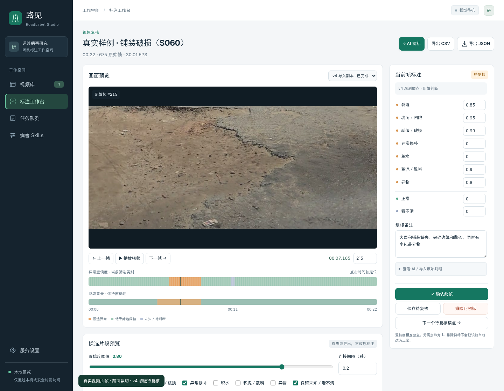
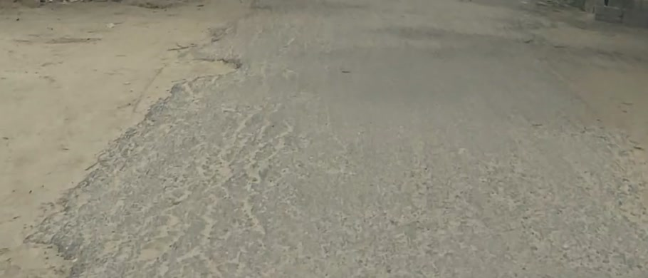
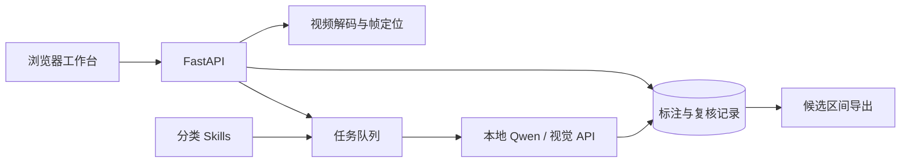

<div align="center">

# 路见 · RoadLabel Studio

**道路巡检视频的 AI 辅助标注与人工复核平台**

`多模态初标` · `逐帧复核` · `分类 Skills` · `时序区间导出` · `模型按需加载`

[功能展示](#功能展示) · [真实道路样例](#真实道路样例) · [快速开始](#快速开始) · [部署指南](docs/deployment.md)

</div>

RoadLabel Studio 将视频上传、视觉模型初标、人工复核和候选区间导出整合到同一工作台，帮助标注者定位可能存在道路病害的片段。支持本地 **Qwen2.5-VL** 与兼容的 **DeepSeek 视觉 API**。

运行实例仅在内部网络开放，不提供对外访问入口。


## 功能展示

| 功能 | 说明 |
| --- | --- |
| 视频管理 | 上传巡检视频，按名称与状态检索，保留原始帧时间戳 |
| AI 辅助初标 | 支持抽帧或逐帧分析，输出多类别置信度与判断依据 |
| 人工复核 | 联动画面与时间轴，逐帧修正分数、记录意见并确认标注 |
| 分类 Skills | 为裂缝、坑洞、积水等异常配置专门判断规则，保存策略版本 |
| 候选区间导出 | 按类别、置信度阈值和相邻间隔筛选，导出 JSON／CSV |
| 模型资源管理 | 任务触发加载，空闲后释放显存，支持队列与状态查看 |



**复核流程：** 定位原始帧 → 查看分类分数与依据 → 检查邻帧并修正 → 确认标注 → 导出候选区间。AI 原始结果与人工修改分别保存。

<details>
<summary><strong>查看更多界面：视频库、AI 配置、候选筛选、Skills 与任务队列</strong></summary>

以下功能截图使用合成演示视频与预设标签。

**视频库**


**AI 初标配置**


**候选区间筛选**


**分类 Skills**


**任务队列**


</details>

## 真实道路样例

以下为 RoadSens-4M 视频的路面裁切图，附项目初版观测分数，供人工复核；每类分数独立取值 `0–1`。

| 裂缝 | 铺装破损 |
| --- | --- |
|  |  |
| 裂缝 **0.95** · 检查不规则网裂 | 剥落／破损 **0.99** · 检查缺损与破碎边缘 |
| **积水** | **正常对照** |
|  |  |
| 积水 **0.95** · 检查水面及边缘 | 正常 **0.90** · 区分标线、阴影与病害 |

[查看标注流程与样例数据](docs/real-examples.md)。图片来源：Amith Khandakar 等人的 [RoadSens-4M Dataset](https://figshare.com/articles/dataset/RoadSens-4M_Dataset/30341143/3)，许可 [CC BY 4.0](https://creativecommons.org/licenses/by/4.0/)。[署名与裁切说明](docs/images/real/ATTRIBUTION.md)。

## 系统架构



**技术栈：** FastAPI · SQLite · FFmpeg · 原生 JavaScript · Qwen2.5-VL

## 快速开始

环境：Python 3.11+、FFmpeg／ffprobe。

```bash
git clone https://github.com/RiT-SS/RoadLabelStudio.git
cd RoadLabelStudio
python3 -m venv .venv
source .venv/bin/activate
python -m pip install -r requirements.txt
python run.py --port 8780
```

打开 <http://127.0.0.1:8780/>。模型接入与内网部署见 [部署指南](docs/deployment.md)，界面演示见 [演示说明](docs/demo.md)。
