

# 路见 · RoadLabel Studio

**道路巡检视频的 AI 辅助标注与人工复核平台**

`多模态初标` · `逐帧复核` · `分类 Skills` · `时序区间导出` · `模型按需加载`

[功能展示](#功能展示) · [样例图](#样例图) · [真实道路样例](#真实道路样例) · [系统架构](#系统架构) · [访问说明](#访问说明)

RoadLabel Studio 将视频上传、视觉模型初标、人工复核和候选区间导出整合到同一工作台，帮助标注者定位可能存在道路病害的片段。支持本地 **Qwen2.5-VL** 与兼容的 **DeepSeek 视觉 API**。

运行实例仅在内部网络开放，不提供对外访问入口。

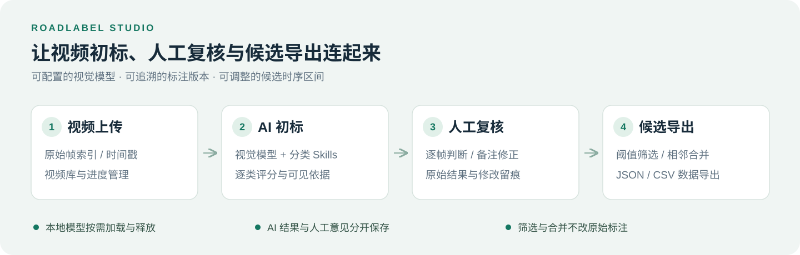

## 功能展示

| 功能 | 说明 |
| --- | --- |
| 视频管理 | 上传巡检视频，按名称与状态检索，保留原始帧时间戳 |
| AI 辅助初标 | 支持抽帧或逐帧分析，输出多类别置信度与判断依据 |
| 任务恢复 | 校验模型输出并自动重试，失败后可继续未完成帧，保留已有标注 |
| 人工复核 | 联动画面与时间轴，逐帧修正分数、记录意见并确认标注 |
| 分类 Skills | 为裂缝、坑洞、积水等异常配置专门判断规则，保存策略版本 |
| 候选区间导出 | 按类别、置信度阈值和相邻间隔筛选，导出 JSON／CSV |
| 模型资源管理 | 根据剩余显存并行调度，支持单卡多任务，空闲后释放模型 |

**复核流程：** 定位原始帧 → 查看分类分数与依据 → 检查邻帧并修正 → 确认标注 → 导出候选区间。AI 原始结果与人工修改分别保存。

## 样例图

**标注工作台** · 逐帧查看病害类别与置信度，记录复核意见。

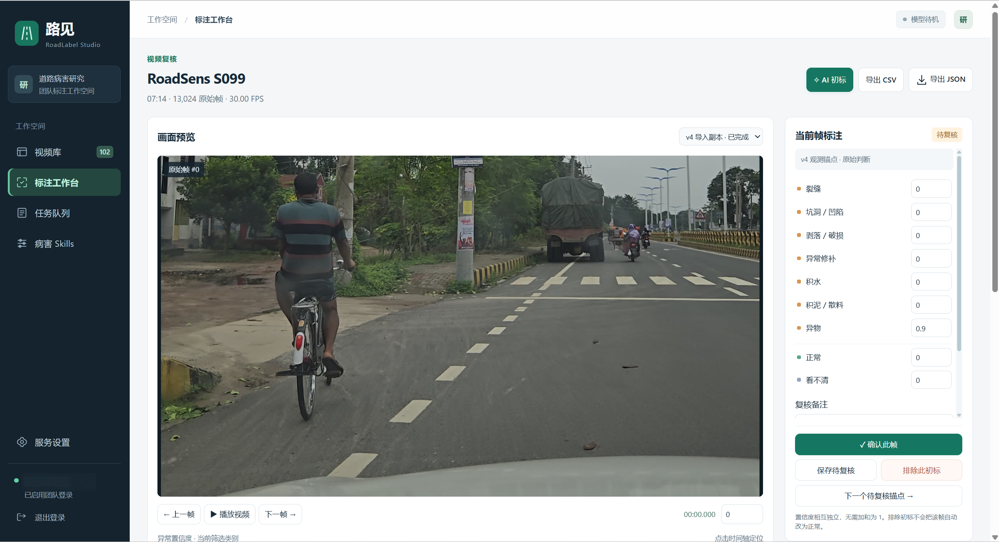

**候选片段筛选** · 按类别、置信度阈值与连接间隔预览候选区间。

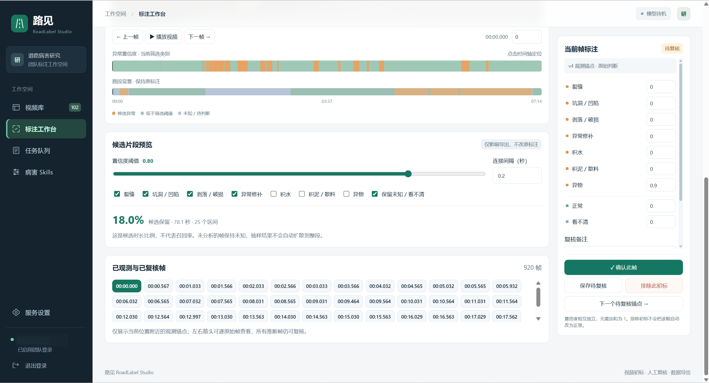

**任务队列** · 查看分析进度与模型状态，继续未完成的标注任务。

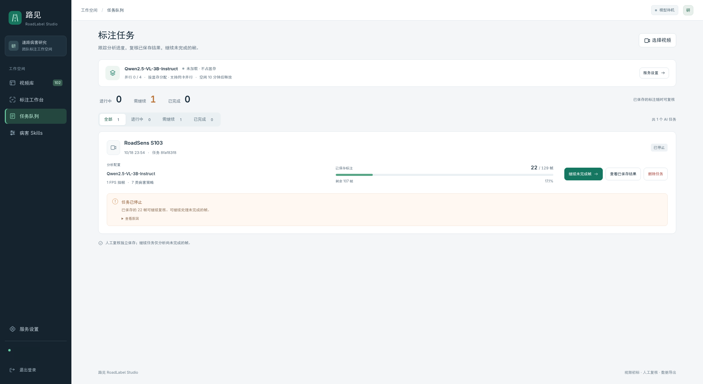

**视频库** · 统一管理巡检视频与标注版本，查看数据规模及复核进度。

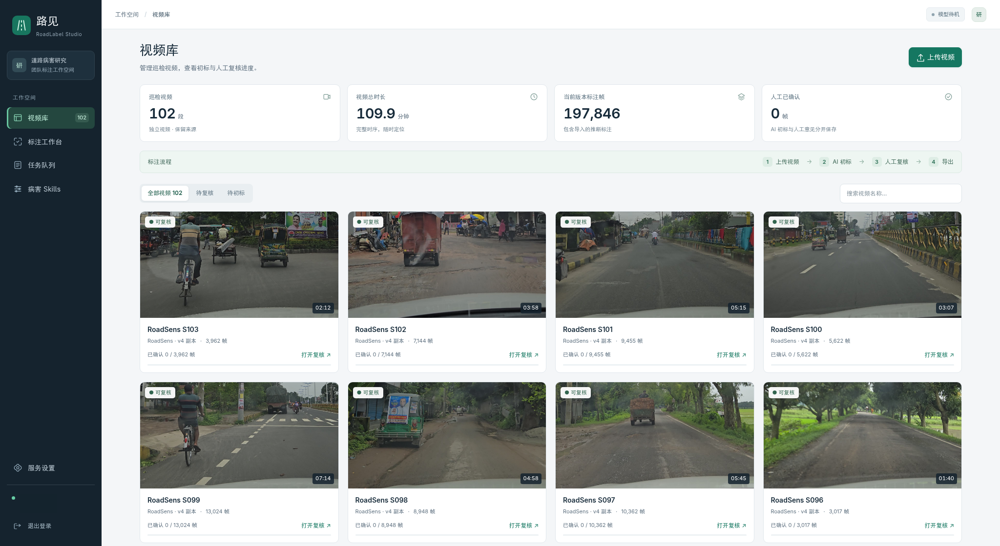

<strong>查看更多界面：视频库、AI 配置、候选筛选、Skills 与任务队列</strong>

以下功能截图使用合成演示视频与预设标签。

**视频库**

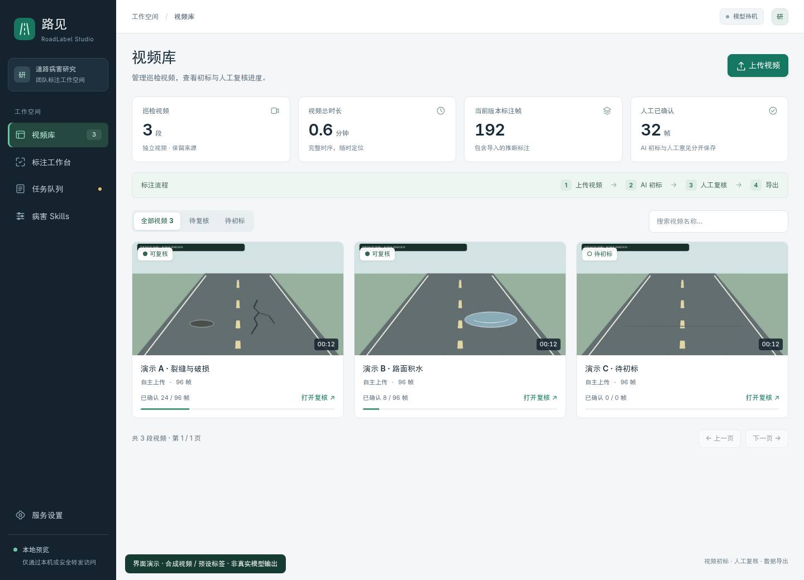

**AI 初标配置**

**候选区间筛选**

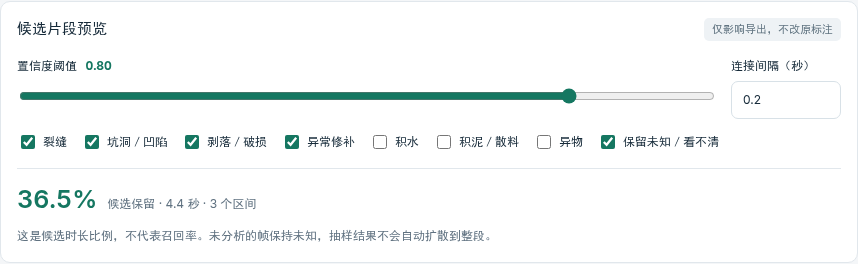

**分类 Skills**

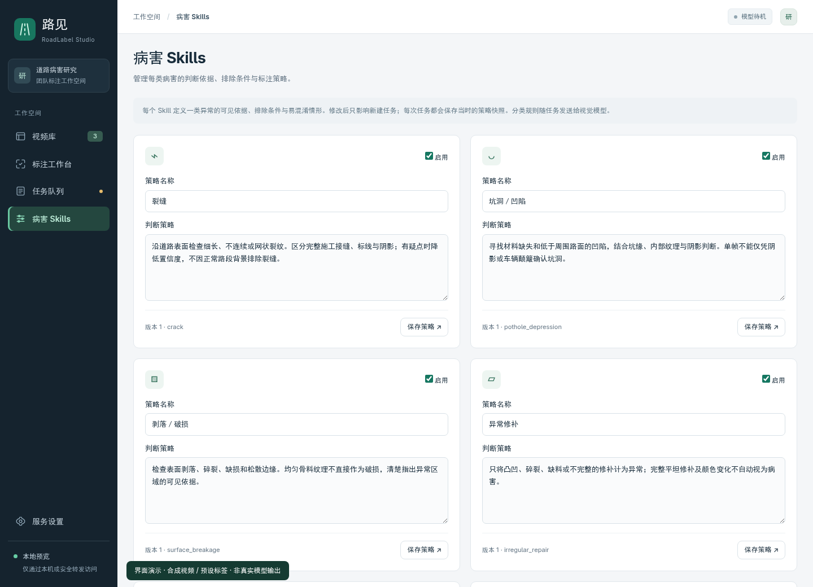

**任务队列**

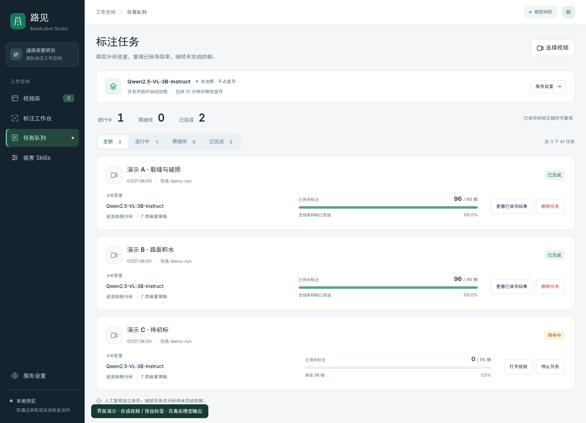

## 真实道路样例

真实道路裁切样例：裂缝选用带标注的公开道路图像，其余来自 RoadSens-4M 视频，附项目初版观测分数（各类独立取值 `0–1`）。

| 裂缝 | 铺装破损 |
| --- | --- |
| 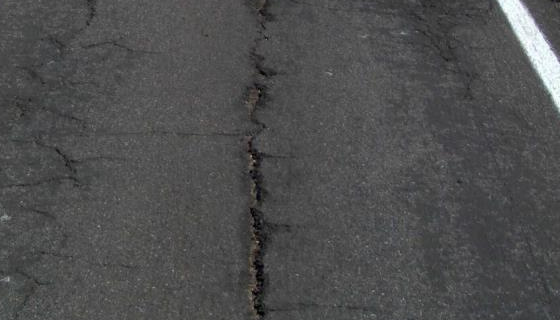 | 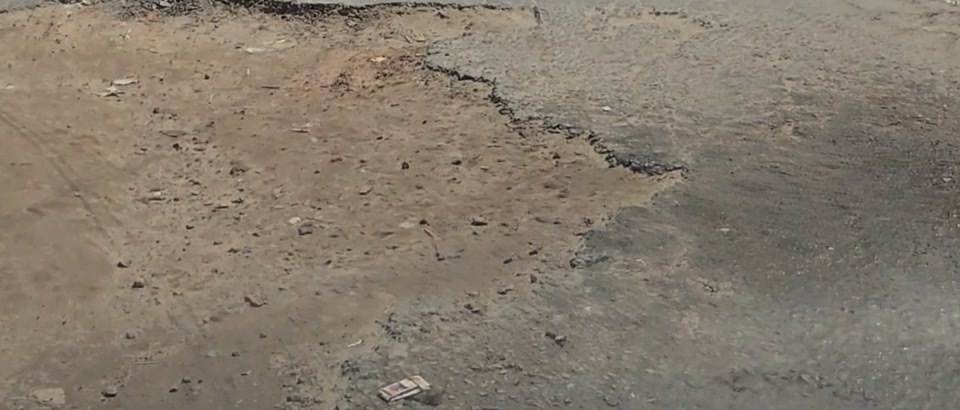 |
| 裂缝 · 观察纵向开口与分叉 | 剥落／破损 **0.99** · 检查缺损与破碎边缘 |
| **积水** | **正常对照** |
| 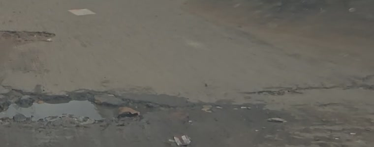 |  |
| 积水 **0.95** · 检查水面及边缘 | 正常 **0.90** · 区分标线、阴影与病害 |

[查看标注流程与样例数据](docs/real-examples.md)。图片来源：[Cracks and Potholes in Road Images](https://data.mendeley.com/datasets/t576ydh9v8/4) 与 [RoadSens-4M](https://figshare.com/articles/dataset/RoadSens-4M_Dataset/30341143/3)，许可 [CC BY 4.0](https://creativecommons.org/licenses/by/4.0/)。[署名与裁切说明](docs/images/real/ATTRIBUTION.md)。

## 系统架构

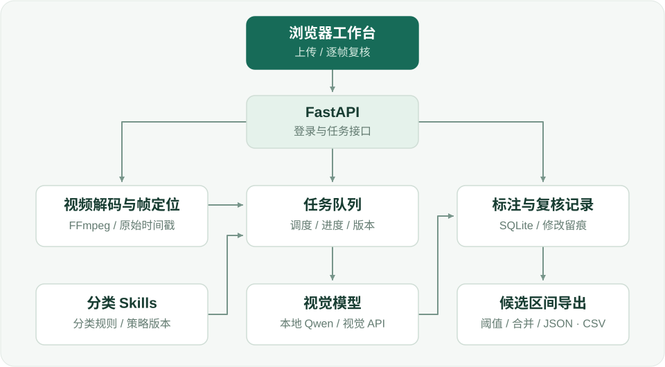

**技术栈：** FastAPI · SQLite · FFmpeg · 原生 JavaScript · Qwen2.5-VL

## 访问说明

本项目为合作项目，平台需连接项目内网使用，不提供面向外部的在线预览或操作入口。本仓库仅公开部分源代码，供技术交流与参考。
